

  

<h1 align="center">Moshe</h1>

<b>My writing app, over a folder of Markdown files.</b> A library, sheets and a plain editor for long texts, with the writing kept as plain files I own, and a translation mode for Hebrew and English side by side.

  
  
  
  
  
  
  

  <a href="docs/README.md"><b>Docs</b></a> ·
  <a href="#install">Install</a> ·
  <a href="#features">Features</a> ·
  <a href="#screenshots">Screenshots</a> ·
  <a href="docs/how-i-use-it.md">One way to use it</a>

<picture>
  <source media="(prefers-color-scheme: dark)" srcset="docs/images/hero-dark.png">
  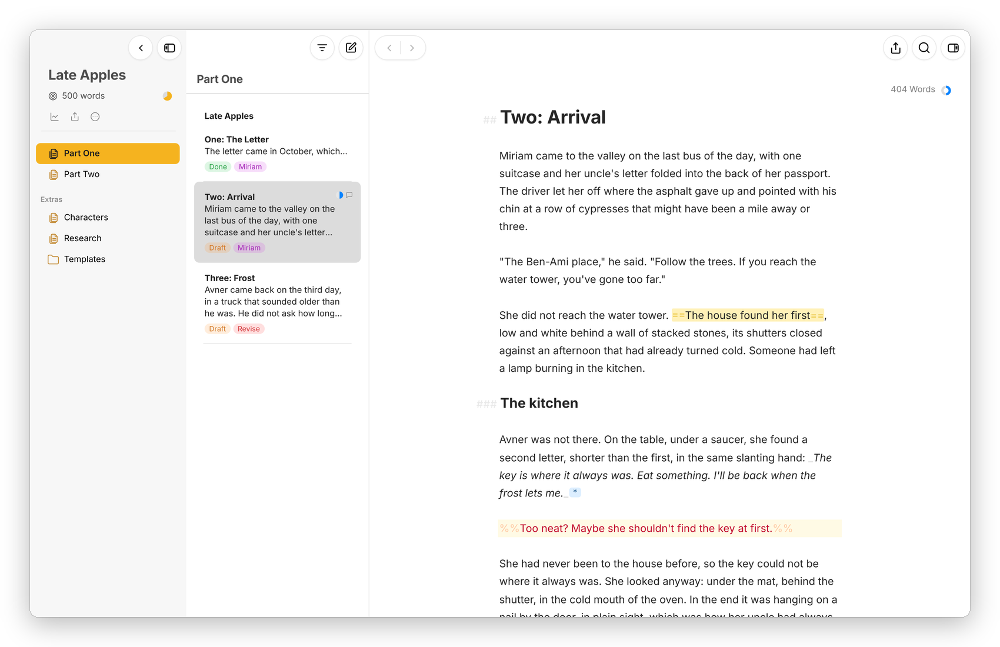
</picture>

## Why I built it

I like writing apps that work a certain way: the library on the left, the sheets in the middle, a plain editor where the Markdown stays visible but greyed out, goals that fill up as I write. The trouble is where they keep the writing. Most keep the texts in a library of their own, which only that app opens, often only on Apple devices, and my phone is Android and all my other notes live in Obsidian.

So I built Moshe. The difference is underneath: the library is a folder of Markdown files. Groups are folders and sheets are `.md` files, which means Obsidian, Syncthing or any text editor can read and change them, and nothing Moshe knows about my writing lives anywhere else.

I also wanted translation in the same place. Moshe has a translation mode: the original and the translation side by side, paragraph beside paragraph, with Hebrew running right to left. Basically, instead of a writing app on one side and a translation tool on the other, I have ONE app where I write, translate and edit, and the files are always mine.

## Features

### Writing

- **Three panes.** The library, the sheet list and the editor side by side (**⌘1**, **⌘2** and **⌘3** choose how many), and the dashboard on the right with **⌘4**. On a phone it's one pane at a time.
- **Markup you can see.** Headings, bold, emphasis, highlights, comments, footnotes, links, images, tables and equations, with the tags greyed in the text. Short tags (`::`, `++`, `||`, `(fn)`, `(tbl)`) typed as you go become the Markdown that Obsidian reads, or CriticMarkup where Markdown has nothing.
- **Sheets and groups.** Notes with an Inbox, projects with their own groups and Extras, glued sheets that read as one text, split and merge, favorites, the Trash with **Put Back**, and project templates for a novel, a non-fiction book, a blog, a paper and a translation.
- **Goals and the dashboard.** A goal for a sheet, a group or a project (words, characters, pages, reading time and more, with a deadline if I want one), the ring that fills as I write, and a history of what I wrote each day.
- **Keywords and filters.** Coloured keywords on sheets, and filters that gather sheets by keyword, text, date, goal or notes.
- **The pen.** On a tablet with a pen, proofreading by hand in Revision Mode: a strike through words deletes them, a caret and a few written words insert, a circle highlights with a comment, all as the same revision marks the menus write. Plus handwritten sheets, a page you just write on like a notebook, with nothing turned into text unless you type it up beside it. It works a lot like Samsung Notes, with seven pens, a highlighter, the lasso, an eraser, the S Pen's button and its round pen menu, shapes that snap clean, and dark or lined or Cornell paper, and it's kept as an Excalidraw drawing that Obsidian's Excalidraw plugin opens too. And sketches saved as SVG pictures beside the sheet. See [The pen](docs/pen.md).
- **Focus.** Focus mode (**⌘.**), which hides every menu and bar until you go up to them or tap, for typing and handwriting alike, and the typewriter options: a line marker, fading everything but the current sentence or paragraph, and fixed scrolling.
- **Themes.** Nine of Moshe's own, each in light and dark, and a copy of any of them to change colour by colour, shared between devices as small files.

### Translation

- **Translation mode.** **⇧⌘T** puts a sheet and its translation side by side, paragraph beside paragraph, and keeps them level as I write, with a count of how many paragraphs are done.
- **The Translation template.** A new project with an Original group and a Translation group, plus Glossary, Queries and Notes in its Extras. The sheets pair up by file name, Hebrew names included.
- **Hebrew everywhere.** Hebrew paragraphs run right to left in the editor and in the exports, and Hebrew spelling is checked as I type.

### Checking the writing

- **As I type.** English grammar and spelling by Harper, and Hebrew spelling by Hunspell with Hspell's dictionary. Both run inside the app, offline, on every device.
- **Check Text.** A whole sheet read by LanguageTool on my server, which catches more, with the suggestions listed in the dashboard. This one needs LanguageTool on the server.

### Your files, always

- **A folder of Markdown.** Highlights are Obsidian's `==mark==`, comments are `%%comment%%`, footnotes are `^[inline]`, and the rest is CriticMarkup. A sheet's keywords and goal sit in its front matter, and a folder's order and colours in a small `.moshe.json` beside it.
- **Edits from anywhere.** Change a sheet in Obsidian while Moshe is open and the change shows up, and if two devices changed the same sheet, Moshe merges them paragraph by paragraph instead of making a conflict copy.
- **Backups.** The server keeps hourly backups for 12 hours, daily for a week and weekly for six months, and **Browse Backups…** restores a copy of any sheet.
- **Import.** Word files (with their comments and tracked changes), Markdown, plain text, TextBundle and web pages become sheets.

### Getting it out, and everywhere

- **Export.** PDF, DOCX, ePub, HTML, Markdown, plain text and TextPack, in seven styles (Everyday, Essay, Business, Manuscript, Papers, Columns and Revision), with a live preview and **Copy for Substack**. A DOCX is a real Word document, and in the Revision style my deletions and insertions arrive as Word's tracked changes and my comments as Word comments.
- **Every device.** The web app, a Mac app with a full menu bar, and an Android app, all working on the same folder.
- **Sync without Syncthing.** The server offers the library over WebDAV, so a phone without Syncthing keeps its own copy in step with a device token.
- **Sheets from outside.** An HTTP API and a command line for making a sheet or adding to one, so Apple's Shortcuts, a bot or a cron job can drop text into the Inbox.

## Screenshots

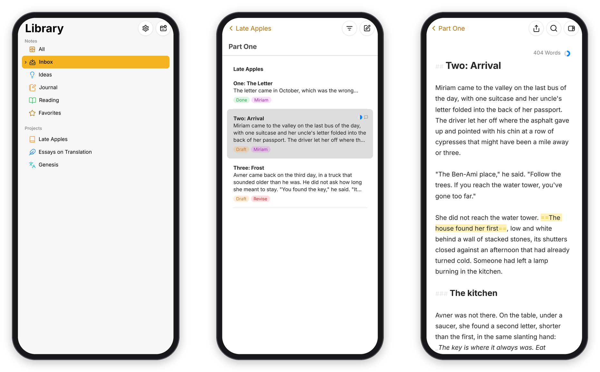

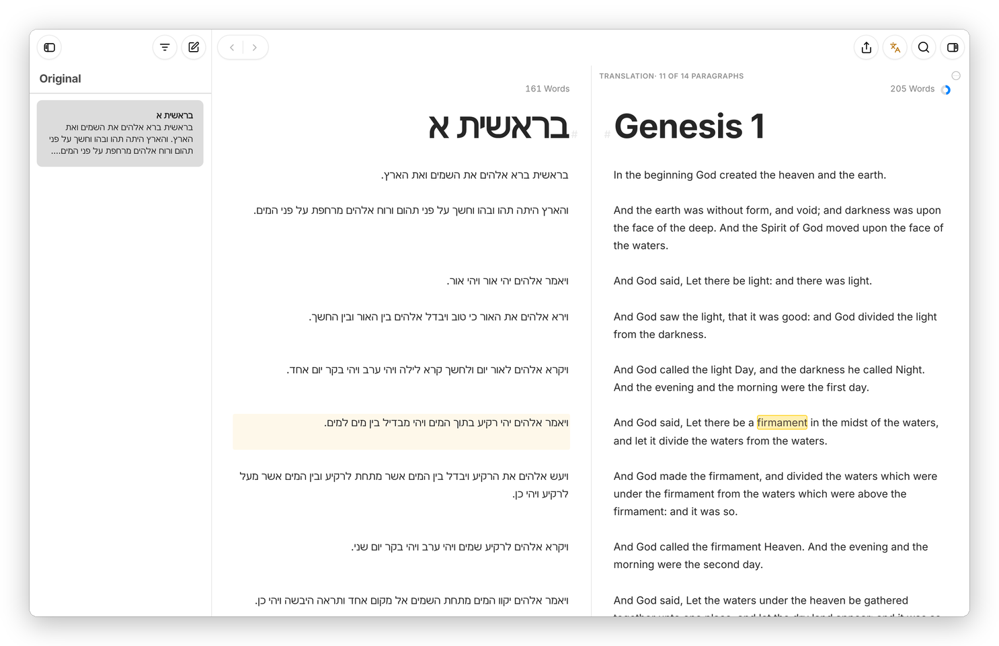
*Translation mode: the Hebrew original beside the English, paragraph beside paragraph, with a note on "firmament".*

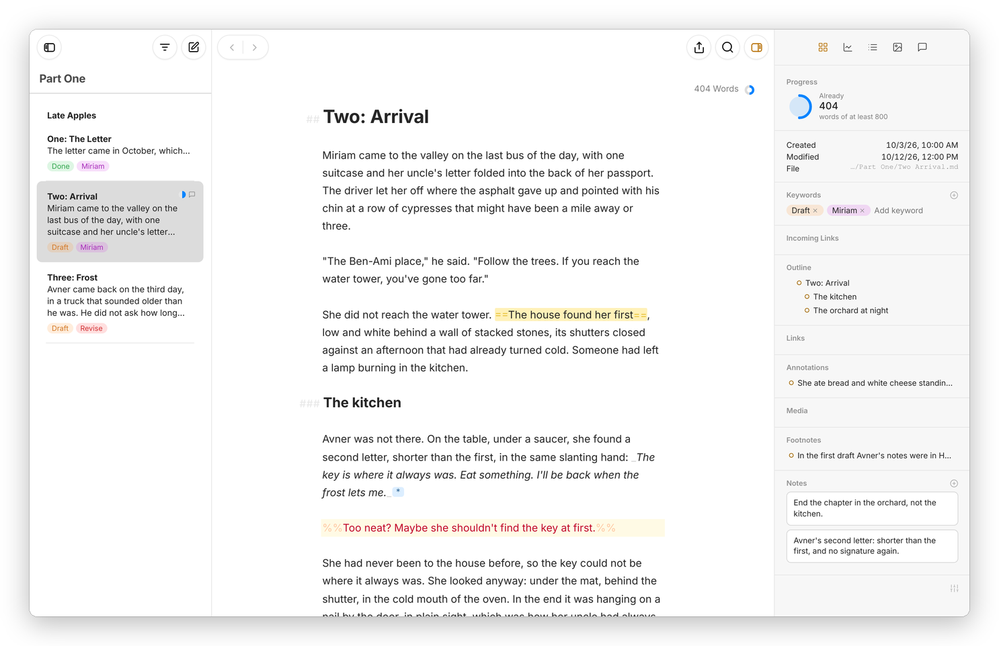
*The dashboard: the goal ring, keywords, the outline, the footnotes and the notes attached to the sheet.*

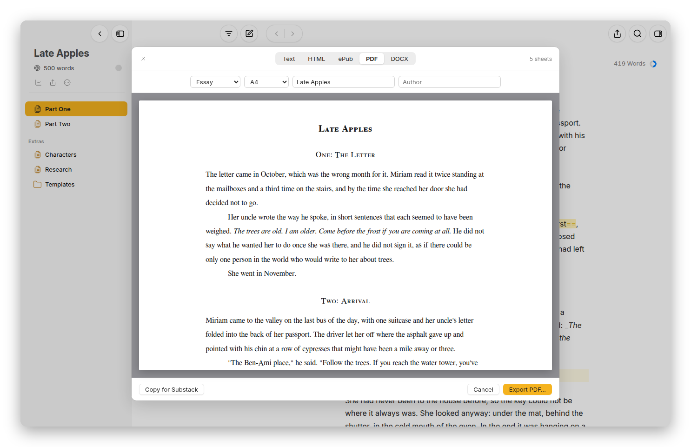
*Export: a whole project as a PDF in the Essay style, with the preview as it will print.*

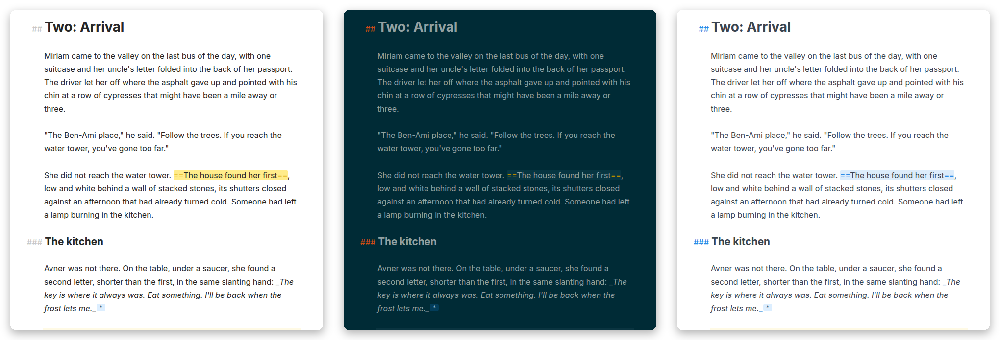
*Three of Moshe's own themes: Classic, Solarized in the dark, and Blue Pencil.*

More screenshots

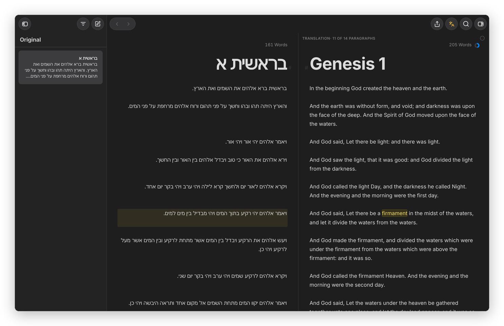
*Translation mode in the dark.*

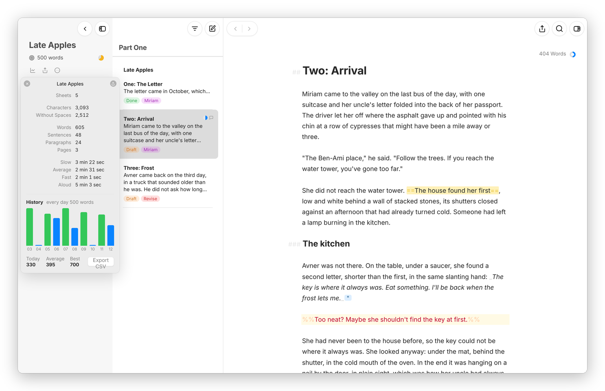
*A project's statistics, with an "every day" goal and the words written each day.*

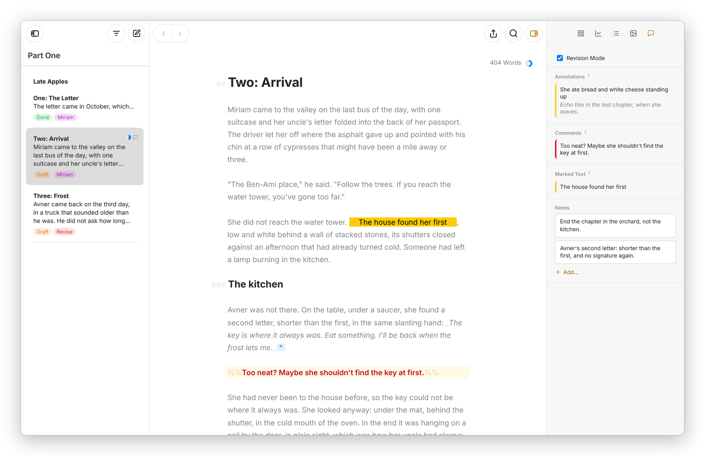
*Revision mode: annotations, comments and highlighted text, listed in the dashboard.*

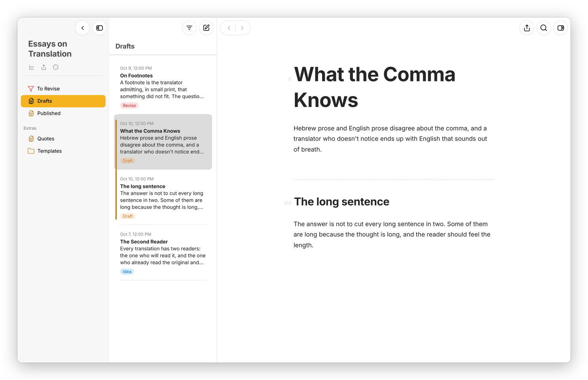
*Glued sheets: two sheets that read as one text in the editor.*

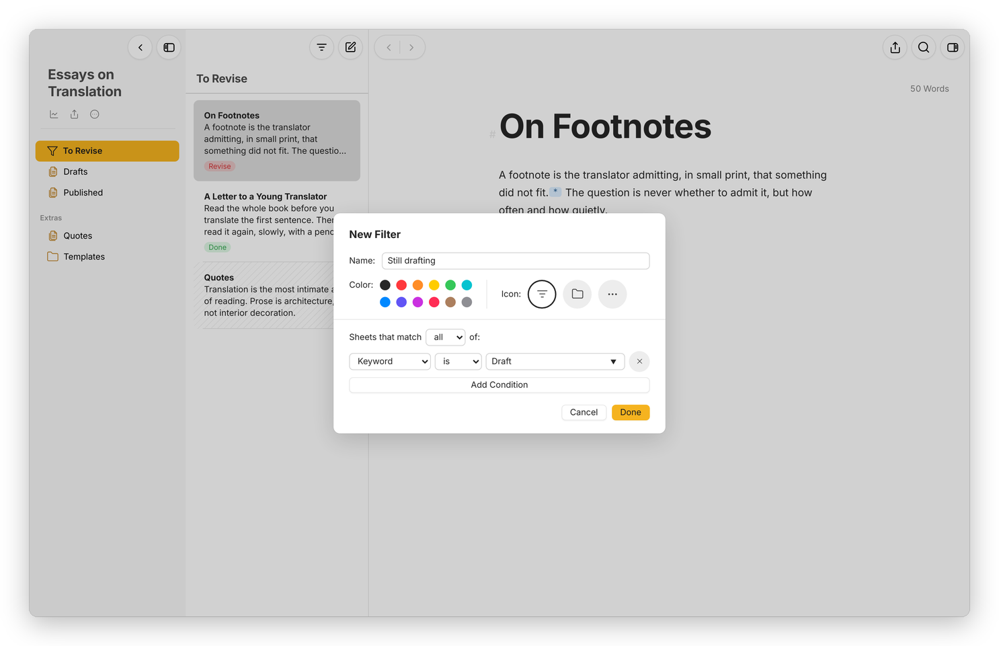
*A filter that gathers every sheet with the keyword Draft.*

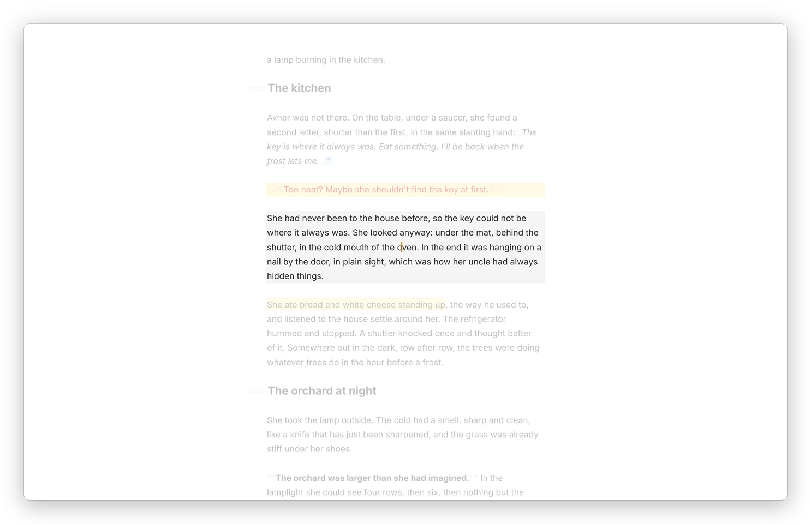
*Focus mode, with the current paragraph bright and the rest faded.*

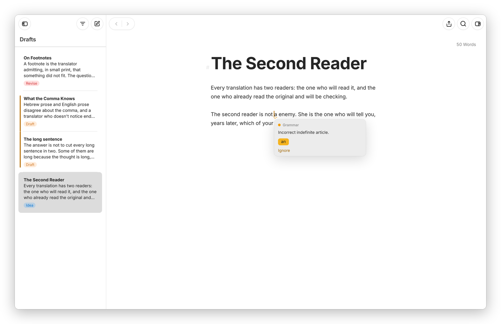
*Grammar as you type: a click on the underline shows what's wrong and the fix.*

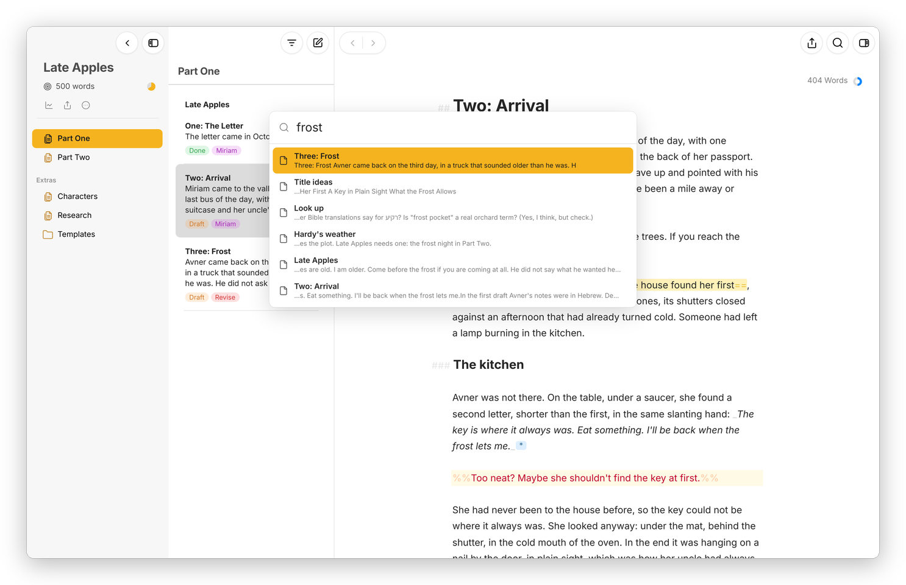
*Open Quickly (⌘O): every sheet with "frost" in it.*

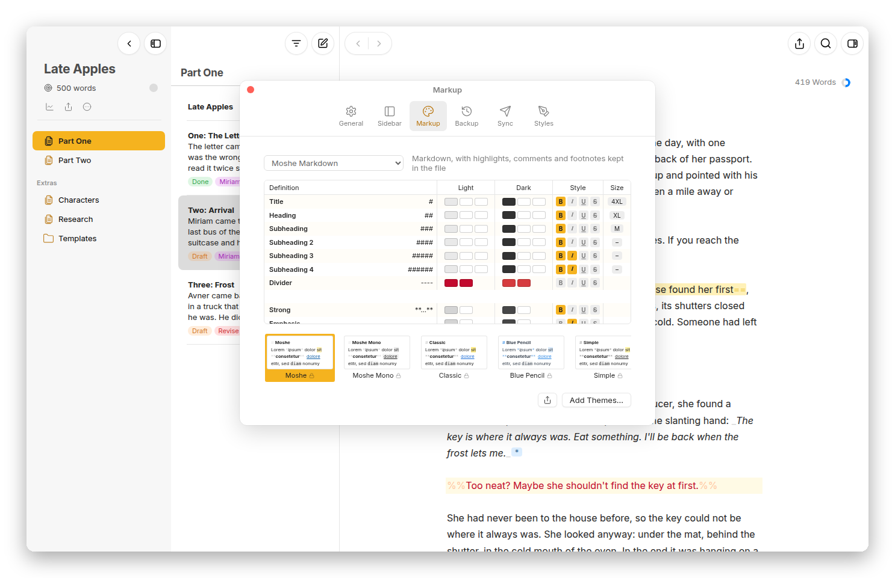
*Settings › Markup: each tag's colours, light and dark, and the themes.*

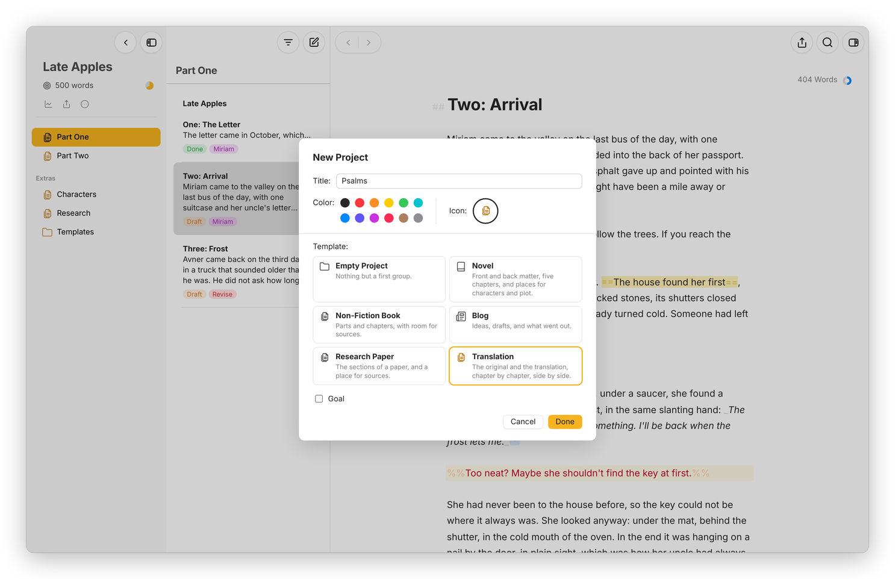
*A new project, from the Translation template.*

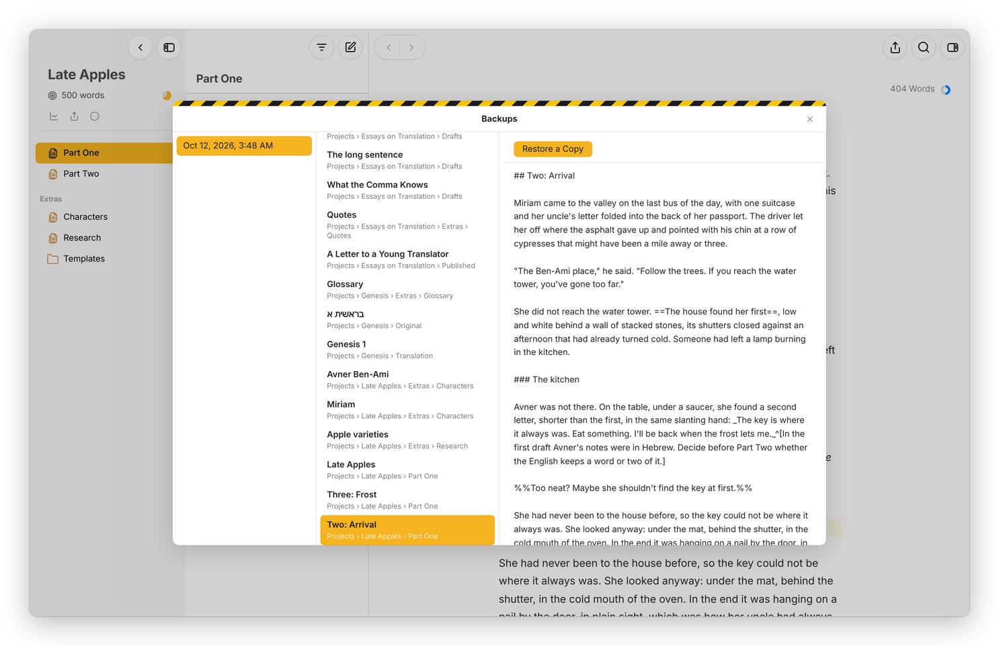
*Browse Backups: any sheet as it was, with Restore a Copy.*

## Install

Moshe is a hobby project that I built for my own writing, so please treat it like one. It's been careful with my files so far, and the server keeps backups, but your writing is worth more than any app. Try it on a COPY of your folder first, keep the folder in a backup of your own, and if something looks wrong, stop and let me know.

### On the web

Moshe is a web app first: open your server's address in any browser and sign in with the password. In Safari on the Mac, **File › Add to Dock** makes it an app of its own, and on a phone, **Add to Home Screen** does the same. The full steps are in [Install](docs/install.md).

### Mac

`brew install --cask franz-rosenzweig/tap/moshe` installs it, and `brew upgrade` keeps it up to date. Each release is also a zip on the [Releases page](https://github.com/franz-rosenzweig/moshe/releases). To build it yourself instead, build the web app, then `mac/build.sh` makes `Moshe.app` in about ten seconds. It needs macOS 14, the Command Line Tools, XcodeGen and Node. See [The Mac app](docs/mac.md) and [mac/README.md](mac/README.md).

### Android

Each release has a signed APK on the [Releases page](https://github.com/franz-rosenzweig/moshe/releases), and [Obtainium](https://obtainium.imranr.dev) pointed at this repository installs it and keeps it up to date. To build it yourself instead, build the web app, then `android/release.sh` makes a signed APK with your own key (or `./gradlew assembleDebug` a test build), which you install with `adb install`. It needs JDK 17, the Android SDK and Node. Out of the box both apps point at my own server when you choose the server, so type your own server's address there. See [The Android app](docs/android.md) and [android/README.md](android/README.md).

### Your own server

The server is one Docker container with no dependencies beyond Node. Point it at the folder that holds your library, set a password, and you're done. See [Your own server](docs/server.md).

## Documentation

The docs explain every part of Moshe the way I'd explain it sitting next to you.

- **Getting started:** [What is Moshe?](docs/what-is-moshe.md), [One way to use it](docs/how-i-use-it.md), [Install](docs/install.md)
- **Writing in Moshe:** [The library](docs/library.md), [Sheets and the editor](docs/editor.md), [Goals and the dashboard](docs/goals-and-dashboard.md), [Keywords and filters](docs/keywords.md), [Translation mode](docs/translation.md), [Writing checks](docs/writing-checks.md), [Focus and the typewriter](docs/focus.md), [Themes and typography](docs/themes.md), [Export and import](docs/export.md), [Keyboard shortcuts](docs/shortcuts.md)
- **Your files:** [The folder, in plain words](docs/your-files.md), [Obsidian and Syncthing](docs/obsidian-and-syncthing.md)
- **Devices and sync:** [The Mac app](docs/mac.md), [The Android app](docs/android.md), [WebDAV sync](docs/webdav.md), [Backups](docs/backups.md)
- **Automation:** [Sheets from outside](docs/automation.md)
- **Running your own server:** [Your own server](docs/server.md)
- **Under the hood:** [The library on disk](docs/FORMAT.md), [The folder bridge](docs/BRIDGE.md), [The menus](docs/MENUS.md), [Developing Moshe](docs/DEVELOPING.md)

Start with [Getting started](docs/what-is-moshe.md).

## How it's built

- **The app** is Svelte 5 and CodeMirror 6, built to static files. The rules (the library on disk, the markup, statistics, merging, export) are plain JavaScript in `engine/`, which runs the same in the page, in Node and in the native apps.
- **The data** is a folder of Markdown files with a small `.moshe.json` in each folder, and no database. Syncthing or the built-in WebDAV sync carries it between devices.
- **The server** is Node with no dependencies: it serves the app and the folder, keeps the backups, offers the folder over WebDAV, and asks for the password. LanguageTool runs beside it only when something asks for it.
- **The Mac and Android apps** are native shells around the same page, which give it a folder on the device through a small bridge, plus the menus, printing, saving and sharing a page can't do well.
- **The tests** run the engine and the server in Node, and the real app in headless Chrome, as the web app and as the Mac and Android apps.

## Credits

- [Svelte](https://svelte.dev) and [Vite](https://vite.dev), MIT.
- [CodeMirror 6](https://codemirror.net), with its Lezer parser and small helper packages, MIT.
- [Lucide](https://lucide.dev) icons (lucide-static), ISC.
- [Harper](https://writewithharper.com) (harper.js), Apache-2.0, for English grammar and spelling.
- [hunspell-wasm](https://www.npmjs.com/package/hunspell-wasm), under LGPL-2.0, GPL-2.0 or MPL-1.1, whichever you pick, with Hspell's Hebrew dictionary from [dictionary-he](https://github.com/wooorm/dictionaries), AGPL-3.0.
- [LanguageTool](https://languagetool.org), LGPL-2.1 or later, run from its own release for **Check Text** (not bundled).
- [fflate](https://github.com/101arrowz/fflate), MIT, which Harper uses.
- [perfect-freehand](https://github.com/steveruizok/perfect-freehand), MIT, which draws the handwriting, and [lz-string](https://github.com/pieroxy/lz-string), MIT, which reads the drawings Excalidraw compressed.
- [OkHttp](https://square.github.io/okhttp/), Apache-2.0, in the Android app, and [XcodeGen](https://github.com/yonaskolb/XcodeGen), MIT, for building the Mac app.

## License

Copyright © 2026 the Moshe authors.

Moshe is free software: you can redistribute it and/or modify it under the terms of the [GNU General Public License](LICENSE) as published by the Free Software Foundation, either version 3 of the License, or (at your option) any later version (`GPL-3.0-or-later`). It comes with no warranty of any kind, as sections 15 and 16 of the [LICENSE](LICENSE) say.

Basically, you can use it, change it, and pass it on, as long as what you pass on stays under the same license and comes with its source. The Hebrew dictionary inside it is under the AGPL-3.0, which section 13 of the GPL allows alongside it, and everything else it's built on is listed under Credits, each under its own license.
