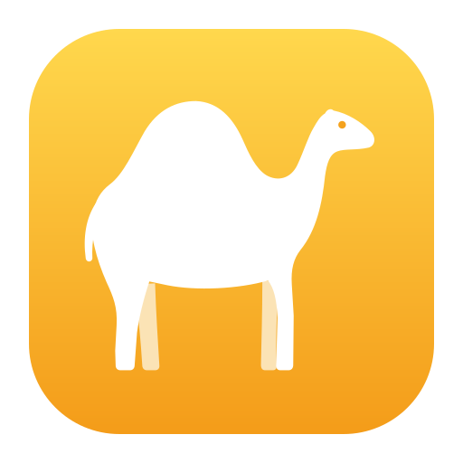

<h1 align="center">Moshe docs</h1>

My writing app, over a folder of Markdown files.

These pages explain Moshe the way I'd explain it to a friend sitting next to me: what each pane is for, what the buttons and keys do, and how it fits into a working day. If you're new, read "What is Moshe?" first and then "One way to use it", which is the quickest way to see how the pieces fit together. If you've used other writing apps for long texts, most of Moshe will feel familiar, and the pages on your files and on translation mode are the ones to read. The pages under "Under the hood" are the working notes for building and running Moshe, and you only need them if you're changing Moshe itself.

### Getting started
- [What is Moshe?](what-is-moshe.md) — what it does, what works where, and what it works with
- [One way to use it](how-i-use-it.md) — translating, writing and keeping notes, from the desk and from the phone
- [Install](install.md) — the web app, the Mac and Android apps, and your own server

### Writing in Moshe
- [The library](library.md) — Notes and the Inbox, projects, groups, the sheet list, favorites and the Trash
- [Sheets and the editor](editor.md) — markup, comments, highlights, footnotes, links, images, glue and split
- [The pen](pen.md) — proofreading marks with a pen, handwritten sheets, and sketches
- [Goals and the dashboard](goals-and-dashboard.md) — goals, the ring, statistics, history and the dashboard's views
- [Keywords and filters](keywords.md) — keywords on sheets, their colours, the Keyword Manager, and filters
- [Translation mode](translation.md) — the original and the translation, paragraph beside paragraph
- [Writing checks](writing-checks.md) — Harper, Hebrew spelling and Check Text
- [Focus and the typewriter](focus.md) — Hide Interface, the line marker, highlighting and fixed scrolling
- [Themes and typography](themes.md) — fonts, line width, Moshe's themes and your own
- [Export and import](export.md) — PDF, DOCX, ePub, HTML and Markdown out; Word and Markdown in
- [Keyboard shortcuts](shortcuts.md) — every key, in one table

### Your files
- [The folder, in plain words](your-files.md) — what's on disk and why nothing is hidden
- [Obsidian and Syncthing](obsidian-and-syncthing.md) — one folder, several apps, and how edits meet

### Devices and sync
- [The Mac app](mac.md) — the window, the menu bar, and a folder on the Mac
- [The Android app](android.md) — where the library lives on the phone, sharing into Moshe
- [WebDAV sync](webdav.md) — a device without Syncthing, kept in step with the server
- [Backups](backups.md) — hourly, daily and weekly, and getting a sheet back

### Automation
- [Sheets from outside](automation.md) — the HTTP API and the command line, for Shortcuts, bots and scripts

### Running your own server
- [Your own server](server.md) — Docker, the password, backups, and LanguageTool

### Under the hood
- [The library on disk](FORMAT.md) — the folder format, key by key
- [The folder bridge](BRIDGE.md) — how the Mac and Android apps give the page a folder
- [The menus](MENUS.md) — the menu bar, item for item, and what each calls in the page
- [Developing Moshe](DEVELOPING.md) — the pieces, running it, the API, the checkers and the tests
- [Moshe for macOS](../mac/README.md) — building and testing the Mac app
- [Moshe for Android](../android/README.md) — building, signing and checking the Android app
- [LanguageTool for Check Text](../languagetool/README.md) — running LanguageTool on demand beside the server
