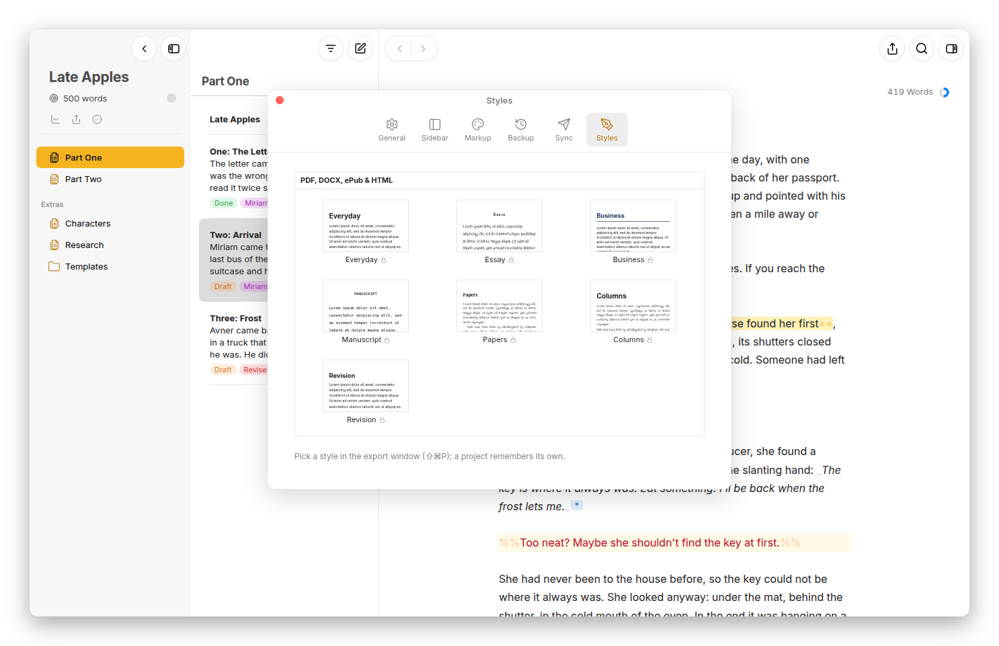

[Moshe docs](README.md) › Writing in Moshe

# Export and import

This page is about getting writing out of Moshe, as PDF, DOCX, ePub, HTML or Markdown, and getting it in, from Word files, Markdown and web pages. Since the library is already Markdown files, you never need to export just to keep a copy, so export is for sending something to someone.

## Exporting

Press **⇧⌘P**, or the export button at the top right of the editor, to export the open sheet, or the sheets you've selected in the list. A sheet glued to others brings them along. For a whole group, right-click it and choose **Export…**, and for a whole project, press the export button under the project's title. Material sheets are always left out.

*A whole project as a PDF in the Essay style, with the preview.*

Along the top of the export window are the formats: **Text**, **HTML**, **ePub**, **PDF** and **DOCX**. Under them are the choices for that format, and below those, a preview that changes as you choose.

- **PDF** and **DOCX**: the style, the page size (**A4**, **US Letter** or **A5**), and the title and author.
- **ePub**: the style, the title and the author, for an e-reader.
- **HTML**: the style, and **Full page** for a page of its own, or without it, just the text to paste somewhere.
- **Text**: **Markdown**, **Plain Text**, or **TextPack (with images)**, the Markdown and its pictures in one file.

Press **Export** (or **Export PDF…**) and the file is saved: in a browser it's downloaded, on the Mac a save panel asks where, and on Android the system asks where to put it. **Copy** puts HTML or Markdown on the clipboard instead, and **Copy for Substack** copies the text so it pastes into a new Substack post with its formatting. Moshe remembers the format and style you used last, and a project remembers its own.

A PDF in a browser goes through the browser's print window, where you choose **Save as PDF**. The Mac app makes the PDF itself and saves it straight to a file, with page numbers, and Android uses its print window too.

## What comes out

Comments, deletions and the Markdown tags never reach the export, and footnotes are numbered. A DOCX is a real Word document: the style becomes Word's own styles (Normal, Heading 1 to 6, Quote), so it can be restyled in Word the usual way, footnotes are Word footnotes, lists are Word lists, and `(toc)` becomes a Word table of contents. Where a paragraph is Hebrew, it comes out right to left, and a book that's mostly Hebrew gets a right-to-left page.

The "style" decides how it looks. There are seven, the same for PDF, DOCX, ePub and HTML, and **Settings › Styles** shows a page of each:

- **Everyday**: clean and neutral, a sans-serif face with generous spacing. Good for anything.
- **Essay**: for essays, a book serif with indented paragraphs and small-caps headings.
- **Business**: reports and proposals, compact, with dark blue headings and a rule under the title.
- **Manuscript**: standard manuscript format for submissions, Courier 12 pt, double-spaced, one-inch margins, chapters on new pages.
- **Papers**: a compact serif page, like a journal article.
- **Columns**: two justified columns under sans-serif headings, like a newsletter.
- **Revision**: for review, with the comments, the deletions struck through, the insertions underlined and the annotations in the margin. As a DOCX, the deletions and insertions become Word's tracked changes and the comments and annotations Word comments, which is how an edited text goes back to its author.

*Settings › Styles: the seven styles, each as the top of a page.*

On the Mac, **File › Print…** (**⌘P**) prints the PDF, and **File › Share…** hands the export to the share sheet.

## Importing

**Import…** (**⇧⌘I**, or in the library's add button) brings files into the selected group, one sheet each. You can also drag files from the Finder onto the sheet list or onto a group.

- **Word** (`.docx`), with its headings, lists, footnotes and links, and its comments and tracked changes as Moshe's own marks.
- **Markdown** (`.md`), with reference footnotes made inline.
- **Plain text** (`.txt`), taken as it is.
- **TextBundle** and **TextPack**, with their pictures.
- **Web pages** (`.html`).

Pictures in a Word file or a TextBundle are saved in the `_media` folder beside the new sheet. If something didn't come across, Moshe says what.

Pasting works too: text copied from Word, Google Docs or a web page keeps its bold, italics, links, headings, lists, quotes and footnotes as markup when you paste it into a sheet.

## A whole project

**Share Project…**, in a project's **More** button or its right-click menu, saves the whole project as a zip, its folders, sheets, settings and pictures exactly as they are on disk. Unzipped into another library's `Projects` folder, it's the project again, which makes it the easy way to hand a project to someone who also uses Moshe.

Next: [Keyboard shortcuts](shortcuts.md) →
