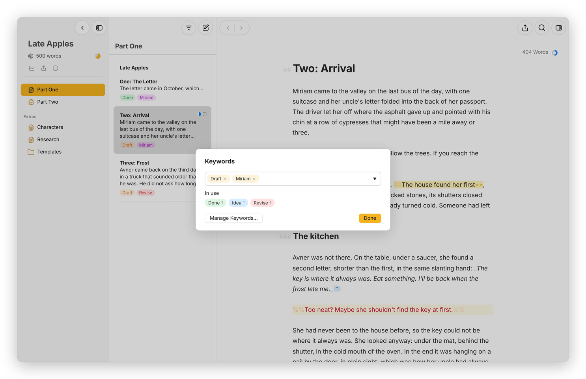
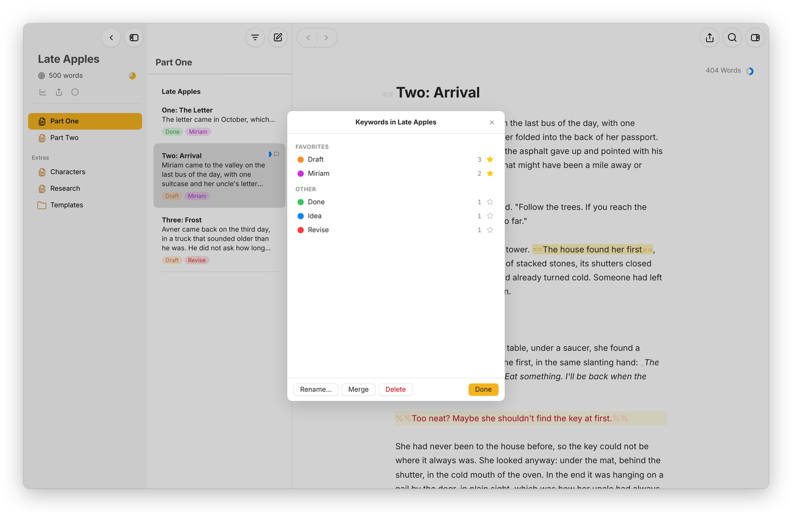

[Moshe docs](README.md) › Writing in Moshe

# Keywords and filters

Keywords are labels you put on sheets, like "Draft", "Revise" or a character's name, and filters are saved searches that gather the sheets with a keyword, or with some text, a date or a goal, from wherever they are. Together they let you see a long project the way you need to that day, without moving a single file.

## Adding keywords

Select one or more sheets and press **⇧⌘K**, or right-click and choose **Keywords…**. Type a keyword and press **Return**, or click one of the keywords already **In use** below the field, which shows how many sheets have each. **Done** closes it.

*The keywords on "Two: Arrival", and the others in use in the project.*

The dashboard's Overview has the same thing for the open sheet: a **Keywords** section with an **Add keyword** field, which suggests the keywords you've used before, and a small **×** on each keyword to take it off. The keywords show under each sheet in the sheet list, in their colours.

In the file, a sheet's keywords are a line in its front matter, `keywords: [Draft, Miriam]`, which Obsidian shows as one of the note's properties. A keyword can have spaces in it.

## Colours and the Keyword Manager

**Manage Keywords…**, in the Keywords window or under the dashboard's sliders button, opens the "Keyword Manager". It lists every keyword with how many sheets use it.

*The Keyword Manager for one project, with two keywords starred as favorites.*

- Click the dot beside a keyword to give it one of twelve colours, or **None**.
- Click the star to make it a favorite, which keeps it at the top under **Favorites**.
- Pick one keyword and press **Rename…** to change it on every sheet that has it.
- Pick two or more and press **Merge** to make them one.
- **Delete** takes a keyword off every sheet that has it.

Each project keeps its own keywords and colours, and the Notes section shares one set for the whole library, which is why the manager's title says "Keywords in" and the project's name when a project is open.

## Filters

A "filter" looks like a group in the library, with its own name, icon and colour, but instead of holding sheets it gathers them. Make one with **New Filter…**: from the **…** beside **Notes**, from a group's right-click menu, from a project's **More** button, or with **⌃⌘N**.

*A filter for every sheet with the keyword Draft.*

Below the name, colour and icon, choose whether sheets should match **all** or **any** of the conditions, and add as many as you need with **Add Condition**:

- **Keyword** is, or is not, a keyword.
- **Text** or **Title** contains, or does not contain, some words. Accents and niqqud don't matter when it compares.
- **Created** or **Modified** in the last so many days, or more than so many days ago.
- **Material sheet**, **Favorite**, **Has a goal** and **Has notes**.

Where you make the filter decides where it looks. A filter in Notes looks through all of Notes, a filter in a project looks through the whole project, and a filter in a group looks through that group and the groups inside it. To change a filter that lives inside a group, right-click it and choose **Edit Filter…**. For now that's the only place it is: a filter at the top of Notes has just **Delete Filter** in its right-click menu, so you delete it and make it again.

Basically, instead of copying the scenes with a character into a group of their own, you make a filter for her keyword, and every scene stays where it belongs.

Next: [Translation mode](translation.md) →
