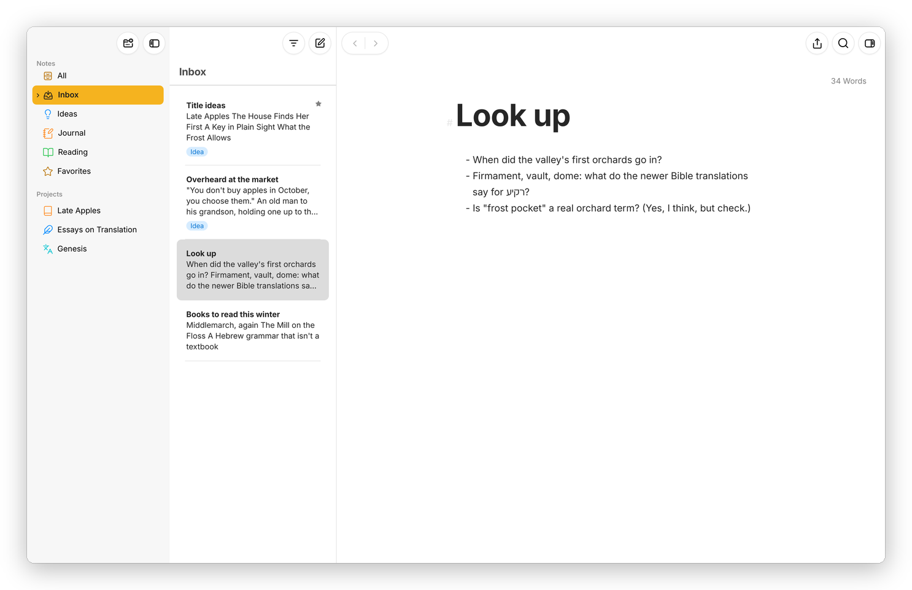

[Moshe docs](README.md) › Writing in Moshe

# The library

The library is the left pane, where everything you write is kept in order: the Notes section with its Inbox, and the projects. This page explains both, the sheet list next to them, and the Trash. Every group here is a folder on disk.

*Notes on the left, with the Inbox selected; its sheets in the middle; one of them in the editor.*

## Notes and the Inbox

The "Notes" section is for loose writing that doesn't belong to a project. Its first rows are **All**, every sheet in Notes, and the **Inbox**, which is where a new sheet goes when nothing else is selected, and where shared text and sheets from outside land. Under them are your groups and filters (filters have a page of their own, [Keywords and filters](keywords.md)), then **Favorites** once something is a favorite, and the **Trash** once something is in it.

A "group" holds sheets and other groups, as deep as you like. Selecting a group shows ALL its sheets in the sheet list, including the ones in the groups inside it, each under its group's name, so you can see a whole book or just one chapter.

To add things, use the button at the top of the library, which offers **New Group…** (**⇧⌘N**), **New Project…**, **New Sheet** (**⌘N**), **New Material Sheet** and **Import…** (**⇧⌘I**). The small **…** button that shows up beside **Notes** when the pointer is over it adds a group or a filter there. Right-click any group for the rest: **New Sheet**, **New Group…**, **New Filter…**, **Edit…** (its name, icon and colour), **Goal…**, **Statistics**, **Sort by**, **Export…**, **Convert to Project** and **Move to Trash**.

## Projects

A "project" is a book, a blog, a paper or a translation: a world of its own. Click one under **Projects** and the library shows that project alone, with its title and goal at the top, its groups, and its "Extras" below them. The three small buttons under the title are **Statistics**, **Export** (the whole project, without its material sheets) and **More**, which has **Edit Project…**, **Add Goal…**, **New Filter…**, **Duplicate Project**, **Share Project…** (the whole project as a zip) and **Archive Project**. The arrow at the top left closes the project.

*New Project… offers six templates, each with its own groups and Extras.*

**New Project…** starts from a template: an empty project, a Novel, a Non-Fiction Book, a Blog, a Research Paper or a Translation, each with the groups it needs and a few Extras groups. You can also drag a group from Notes onto the **Projects** heading to make it a project.

The Extras are for everything that isn't the text: notes, characters, research, a glossary. Every project's Extras has a **Templates** group, and dragging a sheet into it or out of it copies the sheet instead of moving it, which is how you keep a sheet to start from. A sheet in the project but in no group shows up under **Pending**. A project you're done with goes to the **Archive**, at the bottom of the library, and comes back with **Restore from Archive**.

## The sheet list

The middle pane lists the sheets of whatever is selected, with the title and a few lines of each. Small marks on a sheet tell you more: a ring for a goal, a star for a favorite, a paperclip for a "material sheet" (notes and research, left out of export, statistics and goals), a speech bubble for attached notes, and its keywords underneath.

*Two glued sheets, marked by the line on the left, with their dates shown.*

- **Click** a sheet to open it, **Shift-click** or **⌘-click** to pick several (they open one after another in the editor), and **⌥-click** to open one in the second editor.
- **Drag** sheets to reorder them, or onto a group in the library to move them there.
- The **Sort** button beside the title sorts the group **Manually**, **By Title**, **By Modification Date** or **By Creation Date**, with **Reverse Order**.
- The **Filter** button at the top finds sheets in the list as you type, by title, text or keyword.
- Right-click a sheet for **Open in Second Editor**, **Add to Favorites**, **Mark as Material**, **Keywords…**, **Goal…**, **Glue Sheets**, **Merge Sheets**, **Duplicate**, **Rename File to Match Title**, **Export…** and **Move to Trash** (**⌘⌫**).

**Settings › Sidebar** chooses what the library shows. **Global Filters** adds a section at the top with **All**, **Last 7 Days**, **Favorites** and the **Trash**, across the whole library, and **Advanced…** has **Always Show Trash**, **Include Projects in Global Filters**, **Show Inbox Counter** and **Show Project Archive**.

## Finding a sheet

**Open Quickly** (**⌘O**) finds a sheet, a group or a project by its name or by what's written in it, and goes there. **⌘[** and **⌘]** go back and forward through the sheets you've opened, and **⌥⌘↑** and **⌥⌘↓** go to the sheet above or below in the list.

*Open Quickly, with every sheet that mentions frost.*

## The Trash

A sheet or group you delete goes to the Trash, at the path it had, and stays there until you empty it. Right-click it for **Put Back** or **Erase…**, or double-click it to put it back. **Empty Trash** at the bottom of the list erases everything in it. A project has a Trash of its own, inside the project.

Next: [Sheets and the editor](editor.md) →
