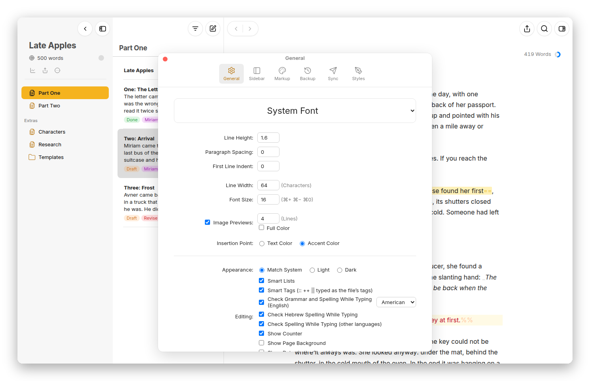

[Moshe docs](README.md) › Writing in Moshe

# Themes and typography

This page is about how the text looks while you write: the font and the spacing, light and dark, and the editor themes, which colour the text and its markup. How the text looks when it leaves Moshe is a different thing, set by the export styles in [Export and import](export.md).

## The font and the spacing

Open **Settings** with **⌘,** (or the gear at the top of the library on a phone). The **General** pane starts with the font, and under it the spacing.

*Settings › General: the font, the spacing, the line width, and the editing options.*

- The font list has **System Font**, **Georgia**, **Iowan Old Style**, **Palatino**, **Charter**, **Avenir Next**, **Helvetica Neue**, **Menlo**, **Courier Prime** and **American Typewriter**, and for Hebrew **Frank Ruehl CLM**, **David CLM**, **Noto Serif Hebrew** and **Noto Sans Hebrew**. A font has to be on the device to show; Moshe doesn't bring its own.
- **Line Height**, **Paragraph Spacing** and **First Line Indent**, for how the paragraphs sit.
- **Line Width**, in characters, and **Font Size**, which **⌘+**, **⌘−** and **⌘0** change too.
- **Image Previews**, how many lines tall a picture shows in the text, and whether in **Full Color**.
- **Insertion Point**, in the **Text Color** or the **Accent Color**.
- **Appearance**: **Match System**, **Light** or **Dark**.

These settings belong to the device you set them on, so the phone can have a bigger font than the Mac.

## Editor themes

A "theme" colours the editor: the text, the background, and each kind of markup, the tags, the highlights, the comments, the links. Every theme has a light and a dark version, and Moshe uses the one that matches the appearance.

*Classic, Solarized in the dark, and Blue Pencil, three of Moshe's own themes.*

Moshe has nine themes of its own, starting with **Moshe**, the one it opens with, and including **Classic**, **Solarized**, **Blue Pencil**, **Yosemite**, **Simple**, **Barely There**, **Moshe Mono** and **No Tags**, which hides the tags altogether. Each has a light and a dark version, so you can keep a theme you like when the Mac goes dark at night, and any of them can be the start of your own.

## Settings › Markup

The **Markup** pane is where you pick a theme and see what it does. The table lists every kind of markup, from the title and headings to comments, footnotes and the selection, with its tag and three colour wells for light and three for dark: the tag, the text and the background. The themes are the strip of cards below it; click one to use it.

*The Markup pane: each kind of markup, its tag and its colours in light and dark, and the themes below.*

Moshe's own themes are locked, so they always stay as they are. Click a colour well on one and Moshe offers to **Duplicate** it, and then the copy is yours to change, well by well; **⌥-click** a well for no colour at all. Right-click a theme card for **Duplicate**, and on your own themes **Rename…**, **Share…** and **Delete Theme**.

Your themes are kept in the library's settings, so every device that opens the library has them. **Share…** saves one as a small `.moshe-theme` file, and **Add Themes…** reads such files back in.

On the Mac, **View › Theme** and **View › Appearance** switch them from the menu bar.

Next: [Export and import](export.md) →
