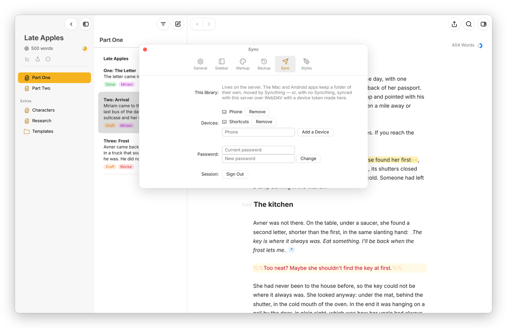

<sub>[Moshe docs](README.md) › Devices and sync</sub>

# WebDAV sync

This page is about keeping a device's own copy of the library in step with your Moshe server when the device doesn't run Syncthing. The usual case is a phone: the Android app keeps the library in its own folder on the phone, and syncs it with the server over WebDAV, using a "device token" instead of your password. The Mac app can do the same with a folder on the Mac.

## On the server: a token for the device

Open Moshe in a browser on the server's address, then **Settings › Sync**. Under **Devices**, type a name for the device, like "Phone", and press **Add a Device**.


*The server's Sync pane: two devices with tokens, and the field to add another.*

Moshe shows the device's token, which starts with `msh_`, and the WebDAV address, which is your server's address with `/dav/` at the end. The token is shown only this once, so copy it now. A device signs in with its token and nothing else, so it never needs your password, and **Remove** beside a device's name takes its token away at once, which is what to do if the phone is lost.

The same pane has **Password**, to change the server's password (which signs out every other browser), and **Sign Out**.

You can make a token on the server's command line too:

```sh
docker exec moshe node server/src/cli.js add-token Phone
```

## On the device: Settings › Sync

In the Android app with **Moshe's own folder, synced with the server**, or in the Mac app on a folder, open **Settings › Sync**. Under **Sync with**, choose **A Moshe server**, type the server's address (just the address, like `https://moshe.example.com`) in **Address** and the token in **Device token**, and press **Save and Sync**.

From then on Moshe syncs on its own: a few seconds after you change something, whenever you come back to the app, and every five minutes while it's open. **Sync Now** does it at once, and **Status** says when it last synced and how many files it sent, took and merged, or why it couldn't.

To stop, choose **Nothing (another app syncs this folder)** and press **Stop Syncing**. That's also the right choice when Syncthing, iCloud Drive or Dropbox already keeps the folder in step, since two syncs on one folder would only get in each other's way.

## Another WebDAV server

**A WebDAV folder** syncs the library with any other WebDAV server instead, like Nextcloud or a Synology: type the folder's full WebDAV address, the user and the password. It works the same way, and the server only needs to store the files.

## How it stays safe

This sync knows more than a tool that only moves files. For every file it remembers the text both sides last agreed on, so when a sheet was changed on the phone and on the server since then, it merges the two against that text, paragraph by paragraph, instead of keeping one and losing the other. It only writes a file on the server if the server's file is still the one it merged with, so nothing written there in the meantime is ever overwritten; that file just waits for the next round. A sheet deleted on one side and changed on the other is kept, with the change.

It carries the sheets, the folders' `.moshe.json`, the library's settings and the Trash. Pictures in `_media` aren't carried, so a picture you add on the phone stays on the phone for now, and the other way round. The address and the token are kept on the device, never in the library.

Basically, instead of setting up Syncthing on a phone, you make one token on the server and type it into the app once.

<sub>Next: [Backups](backups.md) →</sub>
